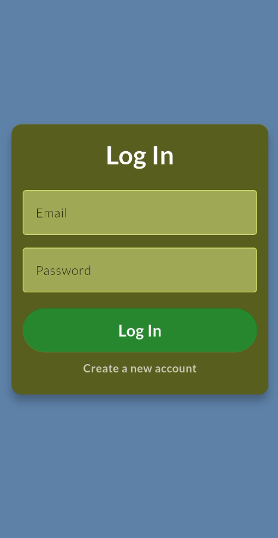
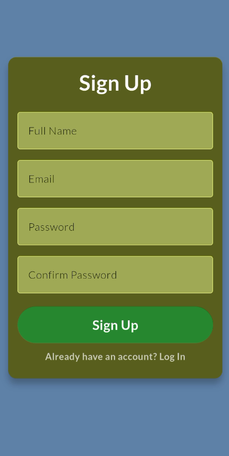
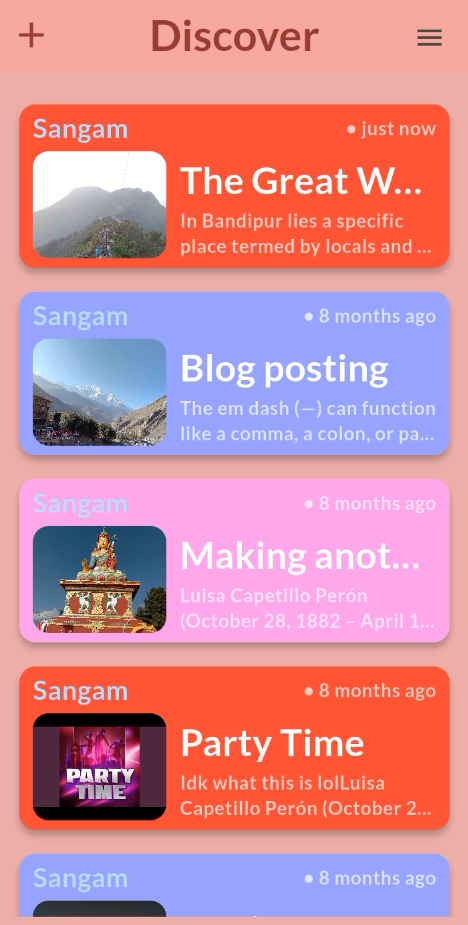
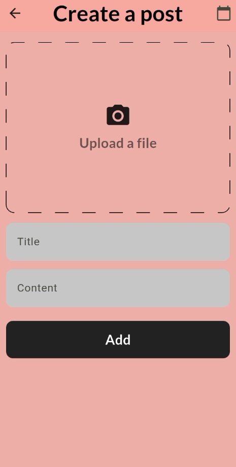
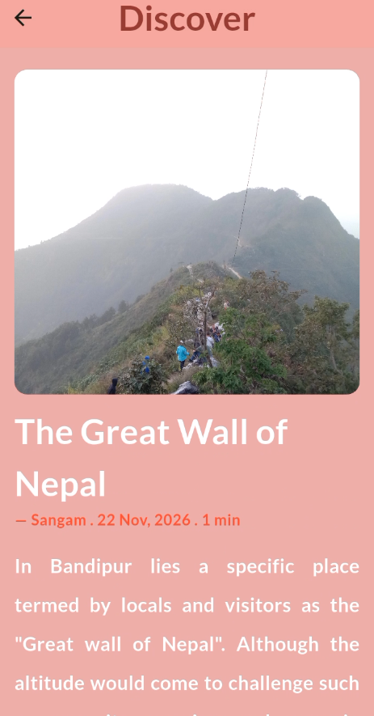

# Blog App

A Flutter app for signing in, sharing image-backed blog posts, and browsing posts from the community. The app keeps a local feed cache so previously loaded posts remain available when the device is offline.

## Features

- Create an account and log in with email and password.
- Browse a feed with author names and relative post times.
- Create a post with a title, written content, and an image.
- Open a post to read the full content and view its image.
- Long-press a post to delete it after confirmation.
- Browse the cached feed while offline.
- Log out from the navigation drawer.

## Screenshots

| Log in | Sign up | Discover feed |
| --- | --- | --- |
|  |  |  |

| Create a post | Read a post |
| --- | --- |
|  |  |

## Tech stack

- **Flutter and Dart** for the app.
- **Supabase Auth** for accounts, **Postgres** for profiles and blog posts, and **Supabase Storage** for post images.
- **flutter_bloc** for app state and **GetIt** for dependency registration.
- **Hive** for the local blog cache.
- **image_picker** for choosing post images and **cached_network_image** for displaying them.

## Configuration

1. Install the Flutter SDK and Android tooling for your device or emulator.
2. Create a Supabase project. The app expects a project URL and a client-side anon/publishable key.
3. Copy `.env.example` to `.env` in the project root, then set the values:

   ```dotenv
   PROJECT_URI=https://your-project-ref.supabase.co
   ANON_KEY=your-supabase-anon-or-publishable-key
   ```

   Keep `.env` out of version control. Do not put a Supabase service-role key in the app.

4. Configure the Supabase backend with a `profiles` table related to `auth.users`, a `blogs` table containing `id`, `user_id`, `title`, `content`, `image_url`, and `updated_at`, and a public `blog_images` storage bucket. Add policies that allow the app’s intended profile, post, and image operations.
5. Install packages and launch the app:

   ```sh
   flutter pub get
   flutter run
   ```

The `.env` file is loaded at startup and is required for the app to connect to Supabase.
